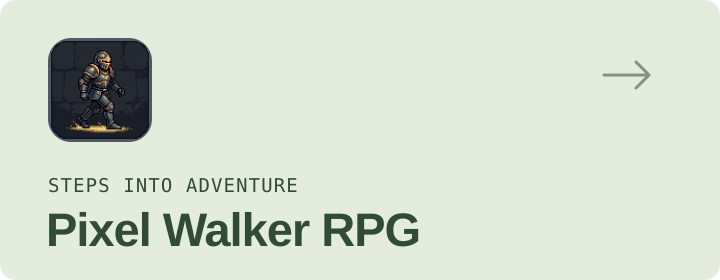
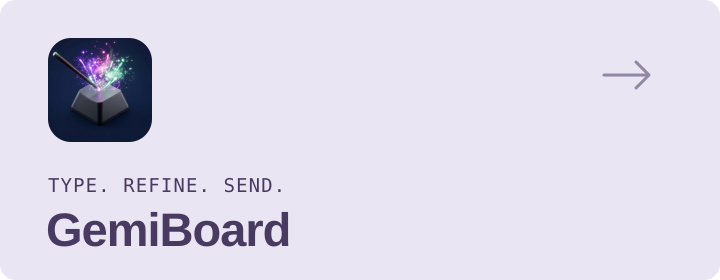
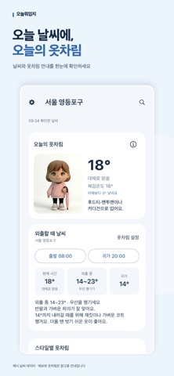
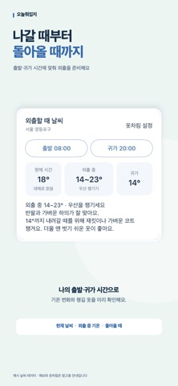
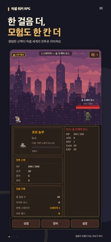
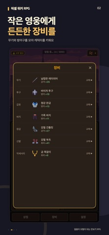

<picture>
  <source media="(prefers-color-scheme: dark) and (max-width: 600px)" srcset="assets/hero-mobile-dark.svg">
  <source media="(max-width: 600px)" srcset="assets/hero-mobile-light.svg">
  <source media="(prefers-color-scheme: dark)" srcset="assets/hero-dark.svg">
  
</picture>

### 안녕하세요, 김동훈입니다.

금융 서비스의 **인증 흐름과 Compose 디자인 시스템**을 개발합니다. 
개인 브랜드 **Tap Studio**에서는 Android·iOS 앱을 직접 기획하고, 출시하고, 운영합니다.

`Kotlin` `Jetpack Compose` `Kotlin Multiplatform` `SwiftUI` `Firebase`

[Email](mailto:welcome2c@naver.com) · [대표 기술 사례](docs/engineering.md) · [경력 상세](docs/experience.md)

## Selected products

일상에서 사용하는 제품을 만들고, 운영 중 만나는 문제를 개선합니다.

<table>
  <tr>
    <td width="50%" valign="top">
      <a href="https://play.google.com/store/apps/details?id=kr.dev.hoony.weathercast">
      <picture>
        <source media="(prefers-color-scheme: dark)" srcset="assets/weathercast-dark.svg">
        
      </picture>
      </a>
      <h3>오늘뭐입지 · WeatherCast</h3>
      
날씨와 외출 시간에 맞는 옷차림 추천. 홈 위젯으로 오늘의 날씨를 빠르게 확인합니다.

      
Kotlin · Compose · SwiftUI · WidgetKit

      
<a href="https://play.google.com/store/apps/details?id=kr.dev.hoony.weathercast">Google Play ↗</a> · <a href="https://apps.apple.com/kr/app/id6758431684">App Store ↗</a>

    </td>
    <td width="50%" valign="top">
      <a href="https://play.google.com/store/apps/details?id=kr.dev.hoony.pixelwalkerrpg">
      <picture>
        <source media="(prefers-color-scheme: dark)" srcset="assets/pixel-walker-dark.svg">
        
      </picture>
      </a>
      <h3>Pixel Walker RPG</h3>
      
걸음 수로 성장하는 만보기 RPG. 센서·백그라운드 집계·퀘스트를 연결합니다.

      
Step sensor · Firebase · SwiftUI · Widgets

      
<a href="https://play.google.com/store/apps/details?id=kr.dev.hoony.pixelwalkerrpg">Google Play ↗</a> · <a href="https://apps.apple.com/kr/app/id6760536041">App Store ↗</a>

    </td>
  </tr>
  <tr>
    <td width="50%" valign="top">
      <a href="https://play.google.com/store/apps/details?id=kr.dev.hoony.gemiboard">
      <picture>
        <source media="(prefers-color-scheme: dark)" srcset="assets/gemiboard-dark.svg">
        
      </picture>
      </a>
      <h3>GemiBoard</h3>
      
한글 입력과 AI 글 교정을 담은 키보드. 천지인 조합 로직과 입력 시퀀스를 직접 다룹니다.

      
InputMethodService · 한글 오토마타 · Gemini

      
<a href="https://play.google.com/store/apps/details?id=kr.dev.hoony.gemiboard">Google Play ↗</a>

    </td>
    <td width="50%" valign="top">
      <a href="https://play.google.com/store/apps/details?id=kr.dev.hoony.popquizdaily">
      <picture>
        <source media="(prefers-color-scheme: dark)" srcset="assets/pop-quiz-daily-dark.svg">
        
      </picture>
      </a>
      <h3>Pop Quiz Daily</h3>
      
매일 풀어보는 상식 퀴즈. KMP로 Android·iOS의 화면과 데이터 계층을 공유합니다.

      
KMP · Compose Multiplatform · Room · Koin

      
<a href="https://play.google.com/store/apps/details?id=kr.dev.hoony.popquizdaily">Google Play ↗</a> · <a href="https://apps.apple.com/kr/app/id6759132499">App Store ↗</a>

    </td>
  </tr>
</table>

<b>실제 앱 화면 보기 · WeatherCast & Pixel Walker</b>

 

**오늘뭐입지 · WeatherCast**

 

**Pixel Walker RPG**

 

<b>More from Tap Studio · 다른 출시 앱</b>

 

| 제품 | 만드는 경험 | 링크 |
| :--- | :--- | :--- |
| **Astro AI** | AI 기반 운세·타로 상담 | [Google Play](https://play.google.com/store/apps/details?id=kr.dev.hoony.astroai) |
| **Voda** | 스크린샷 미디어 검색·Gemini 이미지 분석 | [Google Play](https://play.google.com/store/apps/details?id=kr.dev.hoony.voda) |
| **Meow Bow** | 강아지·고양이 사진 탐색 | [Google Play](https://play.google.com/store/apps/details?id=kr.dev.hoony.meowbow) |
| **Cocktail Wiki** | 칵테일 레시피·즐겨찾기·AI 대화 | [Google Play](https://play.google.com/store/apps/details?id=kr.dev.hoony.cocktailwiki) |
| **Pick It** | 메뉴 선택 룰렛·히스토리·백업과 복원 | [Google Play](https://play.google.com/store/apps/details?id=kr.dev.hoony.pickit) |

## Engineering notes

기능을 만드는 과정에서 만난 문제와, 직접 설계하고 개선한 내용입니다.

**Authentication & reliability** 
금융 앱의 인증 중복 요청·거래 상태 일관성을 개선하고, 화면 전환 결과의 saved state 직렬화 크래시를 수정했습니다.

**Compose design systems** 
다국어 텍스트의 실제 폭을 반영하는 탭과 태블릿 대응 컴포넌트를 개발하고, 공통 UI의 상태·컬렉션·재계산 처리를 개선했습니다.

**Developer experience** 
GitLab CI 기반 AI 코드 리뷰를 최초 구축하고, 초기 모델 분기·변경 라인 검증·Slack 알림을 연결했습니다.

[인증 · 디자인 시스템 · AI 리뷰 · 앱 운영 사례 읽기 →](docs/engineering.md)

## Open source & tools

| 프로젝트 | 담고 있는 경험 |
| :--- | :--- |
| [**CrossPromoSDK**](https://github.com/welcome2c/CrossPromoSDK) | 여러 앱에서 재사용하는 교차 홍보 SDK · Android / iOS / Firestore |
| [**HoonyDisk**](https://github.com/welcome2c/HoonyDisk) | SwiftUI로 만든 macOS 저장 공간 분석·정리 도구 |
| [**LottieProgressDialog**](https://github.com/welcome2c/LottieProgressDialog) | Lottie 애니메이션을 활용한 Android Dialog 라이브러리 |

## Experience

**한화생명 · Android 개발** &nbsp; `2023.02 — 현재` 
인증·보안, Compose 기반 영업지원 앱과 공통 디자인 시스템을 개발합니다.

<b>이전 경력 · 라이브 커머스부터 교육·상담 서비스까지</b>

 

| 기간 | 회사 | 주요 경험 |
| :--- | :--- | :--- |
| 2021.04 — 2023.02 | **모비두** | 소스라이브·소스 스튜디오 · 플레이어·송출·실시간 채팅 |
| 2018.12 — 2020.10 | **한다소프트** | Java → Kotlin 전환 · 상담·결제·영어 학습 서비스 |
| 2017.12 — 2018.10 | **쏘피몬 · 투비시스** | 트레이딩 차트 · STT·챗봇 기반 학습 앱 |

[프로젝트별 경력 상세 →](docs/experience.md)

<b>Tech stack · 분야별 기술</b>

 

| 분야 | 기술 |
| :--- | :--- |
| Android | Kotlin · Java · Jetpack Compose · Coroutines / Flow · Hilt · Room · DataStore · WorkManager |
| Cross-platform & iOS | Kotlin Multiplatform · Compose Multiplatform · SwiftUI · Koin · WidgetKit · ActivityKit |
| Platform & media | InputMethodService · CameraX · ML Kit DocumentScanner · Foreground Service · ExoPlayer |
| Backend & AI | Firebase · Firestore · Remote Config · Cloud Functions · Firebase AI Logic · App Check |
| Delivery & tooling | GitLab CI · GitHub Actions · fastlane · Detekt · AI 코드 리뷰 |

---

[Email](mailto:welcome2c@naver.com) · [GitHub](https://github.com/welcome2c) · **Tap Studio** 
Built with care, by DevHoony.
