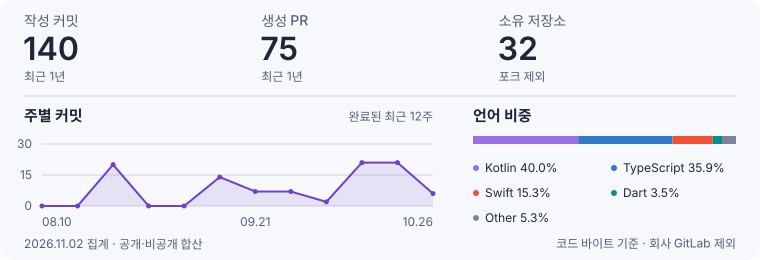
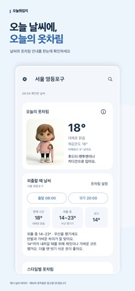

# 김동훈 · Android Developer 👋

2017년부터 금융·라이브 커머스·교육 분야의 **Android 앱**을 개발해 왔습니다.\
현재 **한화생명에서 Android 앱을 개발·운영**하며, **공통 UI와 개발 환경을 개선**하고 있습니다.\
개인 브랜드 **Tap Studio**에서는 Android·iOS 앱을 기획부터 출시·운영까지 직접 만듭니다.

  
  
  
  
  
  

📬 **Contact** · [welcome2c@naver.com](mailto:welcome2c@naver.com)

## GitHub 활동

<picture>
  <source media="(prefers-color-scheme: dark) and (max-width: 600px)" srcset="assets/activity/dashboard-mobile-dark.svg">
  <source media="(max-width: 600px)" srcset="assets/activity/dashboard-mobile-light.svg">
  <source media="(prefers-color-scheme: dark)" srcset="assets/activity/dashboard-dark.svg">
  
</picture>

## 실무 경력

<table>
  <thead><tr><th align="left">회사 · 기간</th><th align="left">제품과 개발 경험</th></tr></thead>
  <tbody>
    <tr>
      <td valign="top" width="100"><strong>한화생명</strong> 2023.02 ~ 현재 Android 개발</td>
      <td><strong>대고객 서비스 · 보험설계사 영업지원 앱 · 소크라택스</strong> Compose 디자인 시스템 · 공통 UI 앱 기능 · 인증 SDK · 세금 신고 시뮬레이션 문서 촬영 · 기기 호환성 · AI 코드 리뷰</td>
    </tr>
    <tr>
      <td valign="top"><strong>모비두</strong> 2021.04 ~ 2023.02 Android 개발</td>
      <td><strong>소스라이브 · 소스 스튜디오</strong> 메인·검색 UI · 영상 재생 · SNS 간편 로그인 · 실시간 채팅 · 구매인증 모바일 라이브 송출 · 방송 상태 제어 · 시청 지표 수집 ExoPlayer · Wowza RTMP · AppSync GraphQL · AWS Kinesis</td>
    </tr>
    <tr>
      <td valign="top"><strong>한다소프트</strong> 2018.12 ~ 2020.10 Android 개발</td>
      <td><strong>운세의 정석 · 영어신</strong> Java → Kotlin 전환 · mVoIP 상담 · 소켓 통신 · 인앱·PG 결제 단어장·사전 데이터 연동 · SQLite·Room 저장·조회 개선</td>
    </tr>
    <tr>
      <td valign="top"><strong>쏘피몬 · 투비시스</strong> 2017.12 ~ 2018.10 Android 개발</td>
      <td><strong>트레이딩 · 영어 학습 서비스</strong> 실시간 시세 차트 · 서버 분석 결과 연동 · 트레이딩 기능 STT 발음 평가 · 오디오 분석 시각화 · 학습 챗봇 UI</td>
    </tr>
  </tbody>
</table>

<b>한화생명 · 기술 사례와 개선 내용</b>

- **Compose 디자인 시스템** — 공통 컴포넌트와 Catalog를 개발하고, 다국어·태블릿에 대응했습니다.\
  탭 라벨을 글자 수 대신 `TextMeasurer`로 측정한 실제 폭에 맞춰 처리했습니다.
- **공통 UI 안정성 개선** — `ImmutableList` 도입과 안정성 어노테이션 정리, `remember`·리스트 key·스타일 캐싱으로 컴포넌트의 상태와 반복 계산을 개선했습니다.
- **인증 화면·SDK 연동** — Android 앱의 로그인·PIN·생체인증 화면과 등록·변경·실패 시 사용자 흐름을 개발했습니다.\
  OnePass SDK의 중복 요청, 거래 상태 일관성, 인증수단 전환 시 콜백 전달을 개선했습니다.
- **메인 앱·네이티브 전환** — 공동인증서 등록과 보안키패드를 연동하고, 웹 기반 회원가입·인증 흐름을 Kotlin 네이티브로 전환했습니다.\
  인증수단 마이그레이션의 미등록 단말·연속 실패·갱신 예외와 폴더블 입력 레이아웃을 개선했습니다.
- **화면 생명주기 문제 해결** — navigation result와 콜백의 saved state 직렬화 크래시를 수정하고, 결과 전달을 메모리 상태로 분리했습니다.
- **기기·운영 환경 대응** — 문서 촬영·DocumentScanner 경로에 Foreground Service를 연결하고, 16 KB 페이지 크기 호환성과 Remote Config 기반 WebView 최소 버전 확인을 적용했습니다.
- **개발 도구 구축** — GitLab CI에 Claude 기반 AI 코드 리뷰를 최초 구축했습니다.\
  초기 모델 분기, diff 헤더 보존, 코멘트 대상 파일·행 검증과 Slack 알림을 개발했습니다.
- **소크라택스** — 종합소득세 신고 시뮬레이션·절세 가이드 개발과 유지보수를 진행했습니다.

## 직접 만든 앱 · Tap Studio

기획·UI/UX·클라이언트·Firebase 백엔드·결제와 광고·스토어 운영까지 직접 진행합니다.

<table>
  <thead><tr><th>앱</th><th align="left">제품 · 기술 · 출시</th></tr></thead>
  <tbody>
    <tr>
      <td width="64" align="center" valign="top"></td>
      <td width="100%"><strong>오늘뭐입지 · WeatherCast</strong> · Android / iOS 날씨와 외출 시간에 맞는 옷차림 추천 앱입니다. Kotlin · Compose · SwiftUI · WidgetKit · Firebase AI Logic <a href="https://play.google.com/store/apps/details?id=kr.dev.hoony.weathercast">Google Play</a> · <a href="https://apps.apple.com/kr/app/id6758431684">App Store</a></td>
    </tr>
    <tr>
      <td align="center" valign="top"></td>
      <td><strong>Pixel Walker RPG</strong> · Android / iOS 걸음 수로 캐릭터를 성장시키는 만보기 RPG입니다. Kotlin · Compose · SwiftUI · 걸음 센서 · Firebase · 위젯 <a href="https://play.google.com/store/apps/details?id=kr.dev.hoony.pixelwalkerrpg">Google Play</a> · <a href="https://apps.apple.com/kr/app/id6760536041">App Store</a></td>
    </tr>
    <tr>
      <td align="center" valign="top"></td>
      <td><strong>GemiBoard</strong> · Android 한글 입력과 AI 문장 교정·변환을 담은 키보드입니다. Kotlin · Compose · InputMethodService · 한글 오토마타 · Gemini <a href="https://play.google.com/store/apps/details?id=kr.dev.hoony.gemiboard">Google Play</a></td>
    </tr>
    <tr>
      <td align="center" valign="top"></td>
      <td><strong>Pop Quiz Daily</strong> · Android / iOS 매일 풀어보는 상식 퀴즈 앱입니다. Kotlin Multiplatform · Compose Multiplatform · Room · Koin · Firebase <a href="https://play.google.com/store/apps/details?id=kr.dev.hoony.popquizdaily">Google Play</a> · <a href="https://apps.apple.com/kr/app/id6759132499">App Store</a></td>
    </tr>
  </tbody>
</table>

<b>대표 앱의 개발·운영 사례</b>

- **오늘뭐입지** — 캐시 우선 날씨 표시, 대기질 재시도와 측정 시각 기반 이전 값 표시를 개선했습니다.\
  위젯 이미지 복구를 Android의 `WorkManager`, iOS의 백그라운드 전송으로 보완했습니다.
- **Pixel Walker RPG** — 걸음 수를 게임 진행과 일일 퀘스트에 연결했습니다.\
  iOS의 백그라운드 걸음 수 반영 누락과 퀘스트 중복 집계를 수정했습니다.
- **GemiBoard** — `InputMethodService` 기반 키보드와 한글 오토마타를 구현했습니다.\
  천지인 복합 모음·연속 탭·타임아웃 처리를 입력 시퀀스 테스트로 확인할 수 있게 구성했습니다.
- **Pop Quiz Daily** — `commonMain`에서 화면·상태·데이터 계층을 공유하고, 플랫폼별 기능을 분리했습니다.\
  Room 기반 기록과 GitLive Firebase, Koin을 공통 코드에 구성했습니다.

<b>실제 앱 화면 · 오늘뭐입지 / Pixel Walker RPG</b>

 

 

### 함께 출시·운영하는 앱

| 앱 | 기능과 개발 경험 | 출시 |
| :--- | :--- | :--- |
| **Astro AI** | Gemini 기반 운세·타로 상담, 로컬 타로 데이터와 상담 기록 | [Play](https://play.google.com/store/apps/details?id=kr.dev.hoony.astroai) |
| **Voda** | 스크린샷 미디어 검색, Gemini 이미지 분석과 구독 연동 | [Play](https://play.google.com/store/apps/details?id=kr.dev.hoony.voda) |
| **Meow Bow** | 강아지·고양이 사진 탐색, 외부 REST API 연동 | [Play](https://play.google.com/store/apps/details?id=kr.dev.hoony.meowbow) |
| **Cocktail Wiki** | 칵테일 레시피, AI 대화와 Room 즐겨찾기 | [Play](https://play.google.com/store/apps/details?id=kr.dev.hoony.cocktailwiki) |
| **Pick It** | 메뉴 선택 룰렛, 히스토리와 Google Drive 백업·복원 | [Play](https://play.google.com/store/apps/details?id=kr.dev.hoony.pickit) |

## 오픈소스 · 개발 도구

| 프로젝트 | 내용 |
| :--- | :--- |
| [**CrossPromoSDK**](https://github.com/welcome2c/CrossPromoSDK) | 여러 앱에서 재사용하는 교차 홍보 SDK · Android / iOS / Firestore |
| [**HoonyDisk**](https://github.com/welcome2c/HoonyDisk) | SwiftUI 기반 macOS 저장 공간 분석·정리 도구 |
| [**LottieProgressDialog**](https://github.com/welcome2c/LottieProgressDialog) | Lottie 애니메이션을 활용한 Android Dialog 라이브러리 |

## 기술 스택

| 분야 | 사용하는 기술 |
| :--- | :--- |
| **Android** | Kotlin · Java · Jetpack Compose · Coroutines / Flow · Hilt · Room · DataStore · WorkManager |
| **iOS·멀티플랫폼** | SwiftUI · Kotlin Multiplatform · Compose Multiplatform · Koin · WidgetKit · ActivityKit |
| **플랫폼·미디어** | InputMethodService · CameraX · ML Kit DocumentScanner · Foreground Service · ExoPlayer |
| **백엔드·AI** | Firebase · Firestore · Remote Config · Cloud Functions · Firebase AI Logic · App Check |
| **개발·배포** | GitLab CI · GitHub Actions · fastlane · Detekt · AI 코드 리뷰 |

---

**김동훈 · DevHoony · Tap Studio** · [welcome2c@naver.com](mailto:welcome2c@naver.com)
